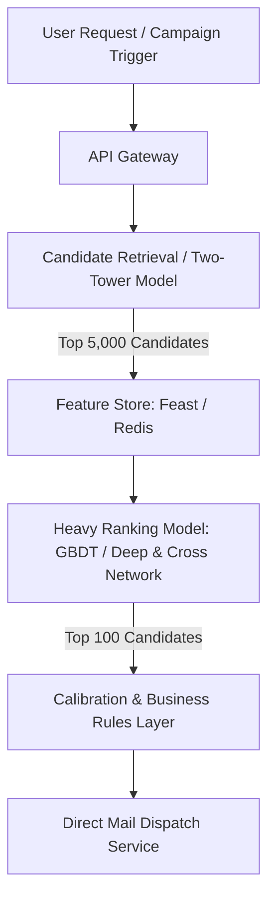

# FAANG Machine Learning Engineer Technical Interview Master Guide

This guide compiles high-frequency, rigorous technical interview questions asked by top-tier engineering organizations (**Meta, Google, Amazon, Apple, Netflix**) based directly on the algorithms, systems, and mathematical techniques implemented across this repository.

---

## Table of Contents
1. [Core ML Foundations & Mathematical Formulations](#1-core-ml-foundations--mathematical-formulations)
2. [Supervised Learning, Feature Engineering & Tabular Modeling](#2-supervised-learning-feature-engineering--tabular-modeling)
3. [Metrics, Evaluation & Bias-Variance Tradeoffs](#3-metrics-evaluation--bias-variance-tradeoffs)
4. [Unsupervised Learning & Dimensionality Reduction](#4-unsupervised-learning--dimensionality-reduction)
5. [Reinforcement Learning & Sequential Decision Making](#5-reinforcement-learning--sequential-decision-making)
6. [Deep Learning, CNN Architectures & Computer Vision](#6-deep-learning-cnn-architectures--computer-vision)
7. [Production ML System Design (FAANG Scale)](#7-production-ml-system-design-faang-scale)
8. [Project Defense & Behavioral Scenarios (STAR Method)](#8-project-defense--behavioral-scenarios-star-method)

---

## 1. Core ML Foundations & Mathematical Formulations

### Q1.1: Derive the Bias-Variance Decomposition of the Mean Squared Error (MSE). What are the practical implications when tuning tree depth in your Boston Housing project?
**Target Companies**: *Google, Meta, Apple*  
**Category**: Theoretical ML / Mathematics

#### Solution & Interview Discussion:
Let the true relationship be $y = f(x) + \epsilon$, where $\mathbb{E}[\epsilon] = 0$ and $\text{Var}(\epsilon) = \sigma^2$.  
Let $\hat{f}(x)$ be the estimator trained on a dataset $\mathcal{D}$.  
The expected prediction error at a test point $x$ is:
$$\mathbb{E}[(y - \hat{f}(x))^2] = \mathbb{E}[((f(x) + \epsilon) - \hat{f}(x))^2]$$
Expanding and taking expectations (using the fact that $\epsilon$ is independent of $\hat{f}(x)$ and $f(x)$):
$$\mathbb{E}[(f(x) - \hat{f}(x) + \epsilon)^2] = \mathbb{E}[(f(x) - \hat{f}(x))^2] + \mathbb{E}[\epsilon^2] + 2\mathbb{E}[(f(x) - \hat{f}(x))\epsilon]$$
Since $\mathbb{E}[\epsilon] = 0$, the cross-term vanishes:
$$= \mathbb{E}[(f(x) - \hat{f}(x))^2] + \sigma^2$$
Add and subtract $\mathbb{E}[\hat{f}(x)]$ inside the expectation:
$$= \mathbb{E}[\left( (f(x) - \mathbb{E}[\hat{f}(x)]) + (\mathbb{E}[\hat{f}(x)] - \hat{f}(x)) \right)^2] + \sigma^2$$
Expanding this gives:
$$= (f(x) - \mathbb{E}[\hat{f}(x)])^2 + \mathbb{E}[(\hat{f}(x) - \mathbb{E}[\hat{f}(x)])^2] + \sigma^2$$
$$= \underbrace{\text{Bias}^2(\hat{f}(x))}_{\text{Systematic error}} + \underbrace{\text{Variance}(\hat{f}(x))}_{\text{Sensitivity to training data}} + \underbrace{\sigma^2}_{\text{Irreducible noise}}$$

**Connection to Project (`boston_housing`)**:
- At `max_depth = 1`, the tree splits only on a single feature threshold. The model family is too restricted to capture nonlinear relationships between `LSTAT`, `RM`, and housing value. **High Bias**, low variance.
- At `max_depth = 10`, each leaf isolates individual noisy training observations. Training error drops to 0, but variance spikes. Test MSE diverges.
- In the interview, explain how **Model Complexity Curves** and **Learning Curves** identify the optimal operating point (around `max_depth = 4`), where the sum of $\text{Bias}^2 + \text{Variance}$ is minimized.

---

### Q1.2: Why does L1 regularization (Lasso) yield sparse solutions while L2 regularization (Ridge) yields diffuse weights? Provide geometric and mathematical justifications.
**Target Companies**: *Amazon, Meta*  
**Category**: Optimization / Regularization

#### Solution & Interview Discussion:
In constrained optimization, regularized regression is formulated as:
$$\min_{w} \mathcal{L}(w) \quad \text{subject to } \|w\|_p \le C$$
- **Geometric View**:
  - The level curves (contours) of the MSE loss function are ellipsoids centered at the OLS solution $\hat{w}_{\text{OLS}}$.
  - The constraint region for $L2$ ($\|w\|_2^2 \le C$) is a smooth hypersphere. The point of tangency between the loss contours and the sphere almost never aligns with the coordinate axes. Hence, weights shrink toward zero asymptotically, but rarely become exactly zero.
  - The constraint region for $L1$ ($\|w\|_1 \le C$) is a diamond/hyper-polyhedron with sharp "corners" situated directly on the coordinate axes. Contours of the objective function are geometrically far more likely to intersect a corner than a flat surface. At these corners, one or more dimensions equal zero ($w_j = 0$).
- **Subgradient Calculus**:
  - The derivative of $L2$ penalty with respect to $w_j$ is $2\lambda w_j$. As $w_j \to 0$, the penalty force also diminishes linearly to $0$.
  - The subgradient of $L1$ penalty is $\lambda \cdot \text{sign}(w_j)$. The penalty force remains constant ($\pm \lambda$) even as $w_j$ approaches zero, forcefully pushing small non-informative coefficients to absolute zero.

---

## 2. Supervised Learning, Feature Engineering & Tabular Modeling

### Q2.1: In the CharityML project (`finding_donors`), why did you apply a logarithmic transformation to continuous features like `capital-gain`? When would you prefer PowerTransform (Yeo-Johnson / Box-Cox) over standard log?
**Target Companies**: *Google, Amazon*  
**Category**: Feature Engineering

#### Solution & Interview Discussion:
1. **The Nature of Financial Skew**:
   - `capital-gain` in Census data is zero-inflated (over $90\%$ of individuals have 0) and possesses a fat right tail reaching $\$99,999$.
   - Without transformation, parametric algorithms (Logistic Regression, Neural Networks, SVM) struggle with non-normal gradient updates: the few extreme values generate massive gradients that dominate the loss function, causing numerical instability and slow convergence.
2. **Formula Choice**:
   - Because $x \ge 0$ includes zeros, $\log(x)$ is undefined at $0$. We apply $\log_e(x + 1)$.
3. **When to use Box-Cox vs. Yeo-Johnson**:
   - **Box-Cox**: Parameterized by $\lambda$ to find the power transform that maximizes Gaussian likelihood:
     $$y^{(\lambda)} = \begin{cases} \frac{y^\lambda - 1}{\lambda}, & \text{if } \lambda \neq 0 \\ \ln(y), & \text{if } \lambda = 0 \end{cases}$$
     *Constraint*: Strictly requires strictly positive values ($y > 0$).
   - **Yeo-Johnson**: Generalizes Box-Cox to allow zero and negative values. In modern tabular pipelines, `PowerTransformer(method='yeo-johnson')` is preferred when distributions contain zeros and negative values.

---

### Q2.2: Walk me through the mathematical difference between Bagging (Random Forest) and Boosting (AdaBoost / XGBoost). Why did AdaBoost perform well on the CharityML dataset?
**Target Companies**: *Meta, Netflix, Amazon*  
**Category**: Ensemble Learning

#### Solution & Interview Discussion:
1. **Bagging (Bootstrap Aggregating)**:
   - Targets **Variance Reduction**.
   - Trains $B$ independent base learners on bootstrap samples of the data in parallel.
   - For $B$ estimators with individual variance $\sigma^2$ and pairwise correlation $\rho$:
     $$\text{Var}(\bar{f}) = \rho \sigma^2 + \frac{1 - \rho}{B} \sigma^2$$
   - As $B \to \infty$, variance approaches $\rho \sigma^2$. Random Forest further reduces $\rho$ by randomly subsetting features at each split (`max_features = sqrt(D)`).
2. **Boosting (Sequential Forward Stagewise Additive Modeling)**:
   - Targets **Bias Reduction**.
   - Trains weak learners sequentially. In **AdaBoost**, each learner $h_t(x)$ focuses on samples misclassified by previous rounds by updating sample weights:
     $$w_i^{(t+1)} = \frac{w_i^{(t)} \exp\left(-\alpha_t y_i h_t(x_i)\right)}{Z_t}$$
     where $\alpha_t = \frac{1}{2} \ln\left(\frac{1 - \epsilon_t}{\epsilon_t}\right)$.
3. **Why AdaBoost succeeded in CharityML**:
   - The census dataset has structured, clean non-linear decision boundaries where individual weak learners (decision stumps) capture independent socioeconomic rules (e.g., `education_num > 12`, `marital-status == Married-civ-spouse`). AdaBoost creates an optimal linear combination of these nonlinear rules without overfitting when early-stopped.

---

## 3. Metrics, Evaluation & Bias-Variance Tradeoffs

### Q3.1: Why was the $F_{0.5}$ metric selected for the CharityML problem instead of standard $F_1$, Accuracy, or ROC-AUC? Give a concrete business cost-benefit justification.
**Target Companies**: *Meta, Netflix, Google*  
**Category**: Metric Design / Business Alignment

#### Solution & Interview Discussion:
1. **Flaw of Accuracy**:
   - Census dataset has a $75/25$ negative/positive class imbalance. A naive zero-rule classifier predicting that nobody earns $> \$50k$ achieves $75.2\%$ accuracy but produces zero business value.
2. **Cost Asymmetry**:
   - Let $C_{\text{mail}}$ be the cost of printing and mailing an outreach letter (e.g., $\$2.00$).
   - Let $R_{\text{donation}}$ be the expected donation amount if an individual earns $> \$50k$ (e.g., $\$50.00$).
   - **False Positive (FP)**: Sending mail to a non-donor costs $\$2.00$ with $\$0$ return.
   - **False Negative (FN)**: Missing a true donor is an opportunity cost, but costs $\$0$ direct capital outlay.
3. **Mathematical Formulation**:
   $$F_{\beta} = (1 + \beta^2) \frac{\text{Precision} \times \text{Recall}}{(\beta^2 \times \text{Precision}) + \text{Recall}}$$
   - When $\beta = 1$: Precision and Recall are weighted equally ($F_1$).
   - When $\beta = 0.5$: $\beta^2 = 0.25$, which weights Precision **twice as heavily** as Recall:
     $$F_{0.5} = \frac{1.25 \cdot P \cdot R}{0.25 \cdot P + R}$$
   - Because CharityML operates on a constrained marketing budget, maximizing the percentage of contacted individuals who actually donate (Precision) is paramount to avoiding budget depletion on non-responsive targets.

---

### Q3.2: When would you evaluate an imbalanced model using the Precision-Recall Area Under Curve (PR-AUC) versus the Receiver Operating Characteristic (ROC-AUC)?
**Target Companies**: *Google, Meta*  
**Category**: Model Evaluation

#### Solution & Interview Discussion:
- **ROC-AUC plots**: True Positive Rate ($\text{TPR} = \frac{TP}{TP + FN}$) vs. False Positive Rate ($\text{FPR} = \frac{FP}{FP + TN}$).
- **PR-AUC plots**: Precision ($\frac{TP}{TP + FP}$) vs. Recall ($\frac{TP}{TP + FN}$).
- **The Core Difference**:
  - The FPR denominator includes True Negatives ($TN$). When the negative class is massive (e.g., ad click fraud where $99.99\%$ are negative), $TN$ is huge. Even if False Positives ($FP$) increase from 10 to 1,000, FPR remains nearly $0$. This produces a falsely optimistic ROC-AUC curve (e.g., $0.98$).
  - Precision directly evaluates $FP$ against $TP$ ($\frac{TP}{TP + FP}$). If $FP$ jumps from 10 to 1,000, Precision plummets immediately.
- **Rule of Thumb**: When evaluating rare-event detection, fraud, spam, or high class imbalance, **PR-AUC is mathematically superior and far more informative**.

---

## 4. Unsupervised Learning & Dimensionality Reduction

### Q4.1: Derive PCA from first principles (maximizing variance of projected data). Why is feature centering strictly required before running PCA?
**Target Companies**: *Google, Apple*  
**Category**: Linear Algebra & Unsupervised Learning

#### Solution & Interview Discussion:
1. **Setup**:
   - Let $X \in \mathbb{R}^{n \times d}$ be a zero-centered data matrix ($\frac{1}{n} \sum_{i=1}^n x_i = 0$).
   - We seek a unit projection vector $u_1 \in \mathbb{R}^d$ ($\|u_1\|_2 = 1$) such that the variance of the projected points $X u_1$ is maximized.
2. **Objective**:
   $$\text{Var}(X u_1) = \frac{1}{n} (X u_1)^T (X u_1) = u_1^T \left( \frac{1}{n} X^T X \right) u_1 = u_1^T \Sigma u_1$$
   where $\Sigma = \frac{1}{n} X^T X$ is the empirical covariance matrix.
3. **Lagrangian Formulation**:
   $$\max_{u_1} \mathcal{L}(u_1, \lambda) = u_1^T \Sigma u_1 - \lambda (u_1^T u_1 - 1)$$
   Take the gradient with respect to $u_1$ and set to 0:
   $$\nabla_{u_1} \mathcal{L} = 2 \Sigma u_1 - 2 \lambda u_1 = 0 \implies \Sigma u_1 = \lambda u_1$$
   This is the fundamental **Eigenvalue Equation**.
4. **Variance Maximization**:
   $$u_1^T \Sigma u_1 = u_1^T (\lambda u_1) = \lambda (u_1^T u_1) = \lambda$$
   To maximize variance, $u_1$ must be the eigenvector corresponding to the **largest eigenvalue** $\lambda_1$ of $\Sigma$.
5. **Why Centering is Required**:
   - If data is not centered, the first principal component simply points from the origin to the center of mass of the data cloud rather than along the axis of maximal variance.

---

### Q4.2: In the Customer Segments project (`customer_segments`), why did you compare Gaussian Mixture Models (GMM) with K-Means? How does the EM algorithm optimize GMM parameters?
**Target Companies**: *Meta, Amazon*  
**Category**: Clustering & Probabilistic Modeling

#### Solution & Interview Discussion:
1. **Limitations of K-Means**:
   - K-Means assumes isotropic, spherical clusters with equal variance and employs hard assignment (each point belongs exclusively to cluster $k$).
   - Real-world spending data (such as wholesale clients buying Fresh vs. Grocery) exhibits non-spherical, correlated spending distributions.
2. **Advantages of GMM**:
   - GMM is a generative probabilistic model modeling the distribution as a mixture of $K$ Gaussians:
     $$p(x) = \sum_{k=1}^K \pi_k \mathcal{N}(x | \mu_k, \Sigma_k)$$
   - It provides **soft clustering probabilities** ($P(\text{Cluster } k | x)$), enabling businesses to quantify customer ambiguity.
3. **Expectation-Maximization (EM) Algorithm**:
   - **E-Step (Responsibility calculation)**: Compute the posterior probability that sample $x_i$ was generated by component $k$:
     $$\gamma_{ik} = \frac{\pi_k \mathcal{N}(x_i | \mu_k, \Sigma_k)}{\sum_{j=1}^K \pi_j \mathcal{N}(x_i | \mu_j, \Sigma_j)}$$
   - **M-Step (Parameter update)**: Re-estimate $\mu_k$, $\Sigma_k$, and mixture weights $\pi_k$ using the responsibilities:
     $$N_k = \sum_{i=1}^n \gamma_{ik}, \quad \mu_k^{\text{new}} = \frac{1}{N_k} \sum_{i=1}^n \gamma_{ik} x_i, \quad \Sigma_k^{\text{new}} = \frac{1}{N_k} \sum_{i=1}^n \gamma_{ik} (x_i - \mu_k^{\text{new}})(x_i - \mu_k^{\text{new}})^T$$

---

## 5. Reinforcement Learning & Sequential Decision Making

### Q5.1: In your Smartcab project (`smartcab`), explain the theoretical differences between Q-Learning and SARSA. Why is Q-Learning classified as an Off-Policy algorithm?
**Target Companies**: *Apple, Google DeepMind, Waymo*  
**Category**: Reinforcement Learning

#### Solution & Interview Discussion:
1. **Update Equations**:
   - **Q-Learning (Off-Policy TD Control)**:
     $$Q(S_t, A_t) \leftarrow Q(S_t, A_t) + \alpha \left[ R_{t+1} + \gamma \max_{a} Q(S_{t+1}, a) - Q(S_t, A_t) \right]$$
   - **SARSA (On-Policy TD Control)**:
     $$Q(S_t, A_t) \leftarrow Q(S_t, A_t) + \alpha \left[ R_{t+1} + \gamma Q(S_{t+1}, A_{t+1}) - Q(S_t, A_t) \right]$$
     where $A_{t+1} \sim \pi(\cdot | S_{t+1})$ is the action *actually chosen* by the current behavioral policy.
2. **Why Q-Learning is Off-Policy**:
   - The behavioral policy generating the agent's actions is $\epsilon$-greedy (probabilistic exploration).
   - However, the target update uses $\max_{a} Q(S_{t+1}, a)$, which evaluates the purely greedy optimal policy $\pi^*$.
   - Because the target policy ($\pi^*$) differs from the behavior policy ($\epsilon$-greedy), Q-Learning is **off-policy**.
3. **Safety Implications in Smartcab**:
   - In cliff-walking or autonomous driving, Q-Learning learns the optimal path along the edge of safety rules. If $\epsilon > 0$, the agent may occasionally take a random exploration action and run a red light. SARSA, being on-policy, accounts for the agent's exploratory nature and learns a safer, more conservative trajectory.

---

### Q5.2: How did you prevent the Curse of Dimensionality when designing the Smartcab's state space? What happens if you add absolute GPS coordinates $(x, y)$ to the state?
**Target Companies**: *Waymo, Amazon Robotics, Meta*  
**Category**: State Space Design / MDP Formulation

#### Solution & Interview Discussion:
1. **Ego-Centric vs. Global State Space**:
   - If absolute coordinates $(x, y) \in [1..8] \times [1..6]$ are included, the agent would need to learn how to handle red lights at intersection $(2, 3)$, and then relearn the exact same traffic rule from scratch at intersection $(4, 5)$. The state space explodes by a factor of 48, requiring $48\times$ more training iterations to achieve policy convergence.
2. **Discretization & Abstraction**:
   - By structuring state $s = (\text{light}, \text{oncoming}, \text{left}, \text{next\_waypoint})$, the state size was constrained to:
     $$|S| = 2 \times 4 \times 4 \times 3 = 96 \text{ states}$$
   - This compact tabular representation allowed the agent to fully populate its Q-table in under 1,000 simulated trials while achieving an A+ Safety Rating.

---

## 6. Deep Learning, CNN Architectures & Computer Vision

### Q6.1: Compute the exact output dimensions and parameter count for a convolutional layer given an input volume of $32 \times 32 \times 3$, 64 filters of size $5 \times 5$, stride 1, and padding 'SAME'.
**Target Companies**: *Apple, Meta, Google*  
**Category**: Deep Learning Foundations

#### Solution & Interview Discussion:
1. **Output Spatial Dimension Formula**:
   $$W_{\text{out}} = \left\lfloor \frac{W_{\text{in}} - K + 2P}{S} \right\rfloor + 1$$
   With padding 'SAME', $P = \frac{K - 1}{2} = \frac{5 - 1}{2} = 2$.
   $$W_{\text{out}} = \frac{32 - 5 + 2(2)}{1} + 1 = 32$$
   $$H_{\text{out}} = 32$$
   Output Volume: **$32 \times 32 \times 64$**.
2. **Trainable Parameter Count**:
   - Each filter has dimension: $K_h \times K_w \times C_{\text{in}} = 5 \times 5 \times 3 = 75$ weights.
   - Plus 1 bias term per filter: $75 + 1 = 76$ parameters.
   - For 64 filters:
     $$\text{Total Parameters} = 64 \times (5 \times 5 \times 3 + 1) = 64 \times 76 = \mathbf{4,864} \text{ parameters}$$

---

### Q6.2: Explain the internal mechanism of Batch Normalization. Why does it accelerate training, and what critical change occurs during inference/evaluation mode?
**Target Companies**: *Meta, Google, Netflix*  
**Category**: Deep Learning Optimization

#### Solution & Interview Discussion:
1. **Training Phase (Mini-Batch Calculation)**:
   For a mini-batch $\mathcal{B} = \{x_1, \dots, x_m\}$:
   $$\mu_{\mathcal{B}} = \frac{1}{m} \sum_{i=1}^m x_i, \quad \sigma_{\mathcal{B}}^2 = \frac{1}{m} \sum_{i=1}^m (x_i - \mu_{\mathcal{B}})^2$$
   Normalize:
   $$\hat{x}_i = \frac{x_i - \mu_{\mathcal{B}}}{\sqrt{\sigma_{\mathcal{B}}^2 + \epsilon}}$$
   Scale and shift with learnable parameters $\gamma, \beta$:
   $$y_i = \gamma \hat{x}_i + \beta$$
2. **Why It Accelerates Training**:
   - Smoothes the optimization landscape (makes the Lipschitz constant of the loss function and gradients smaller and more predictable), allowing substantially higher learning rates without divergence.
   - Mitigates internal covariate shift in deep networks.
3. **Inference Phase (Evaluation Mode)**:
   - During inference, single samples may arrive one at a time ($m=1$). Computing batch statistics is impossible.
   - Instead, the network uses exponential moving average (EMA) statistics tracked during training:
     $$\mu_{\text{running}} = (1 - \rho)\mu_{\text{running}} + \rho \mu_{\mathcal{B}}$$
     $$\sigma_{\text{running}}^2 = (1 - \rho)\sigma_{\text{running}}^2 + \rho \sigma_{\mathcal{B}}^2$$
   - The normalization uses these fixed constants: $\hat{x} = \frac{x - \mu_{\text{running}}}{\sqrt{\sigma_{\text{running}}^2 + \epsilon}}$.

---

## 7. Production ML System Design (FAANG Scale)

### Q7.1: Design an End-to-End Real-Time CharityML Donation Ranking System handling 100M profiles with 50ms latency SLA.
**Target Companies**: *Meta, Google, Amazon*  
**Category**: ML System Design

#### Solution & Key Architecture Components:
1. **Multi-Stage Pipeline**:
   - **Retrieval Layer (Candidate Generation)**: Filter 100M profiles down to 5,000 promising candidates using Approximate Nearest Neighbors (HNSW index via Faiss) on pre-computed user demographic embeddings.
   - **Ranking Layer**: Pass the 5,000 candidates through a high-precision ranker (e.g., CatBoost or Deep & Cross Network) scoring $P(\text{Donation} > \$50k | \text{User})$.
   - **Calibration & Filtering**: Apply temperature scaling or isotonic regression to calibrate raw logits into true probabilities, ensuring thresholding at $F_{0.5}$ optimal operating point.
2. **Feature Store Strategy**:
   - **Offline Store (Snowflake / BigQuery)**: Historical features for batch training.
   - **Online Store (Redis / DynamoDB)**: Sub-millisecond lookup for dynamic user attributes (recent activity, donation frequency).
3. **Drift & Retraining Loop**:
   - Continuous evaluation of Population Stability Index (PSI):
     $$\text{PSI} = \sum \left( \% \text{Actual}_k - \% \text{Expected}_k \right) \times \ln\left(\frac{\% \text{Actual}_k}{\% \text{Expected}_k}\right)$$
   - When $\text{PSI} > 0.2$, automatic pipeline triggers retrain on Amazon SageMaker / Kubeflow.

---

## 8. Project Defense & Behavioral Scenarios (STAR Method)

### Q8.1: "Tell me about a time your model suffered from severe overfitting in a real project. How did you identify it, and what was your remediation plan?"
**Context**: Answering based on `boston_housing` and `image-classification`.

- **Situation (S)**: In the housing regression and CIFAR-10 image classification tasks, initial model architectures exhibited severe overfitting: training $R^2$ was $0.99$ while test $R^2$ hovered below $0.65$; in CIFAR-10, training accuracy approached $95\%$ while validation accuracy stalled at $68\%$.
- **Task (T)**: I needed to diagnose whether the root cause was excessive model capacity, insufficient training data volume, or lack of regularization, without sacrificing model expressiveness.
- **Action (A)**:
  1. In the decision tree regressor, I plotted **Learning Curves** and **Complexity Curves** using cross-validation. This confirmed high variance beyond depth 4. I tuned `max_depth` and `min_samples_leaf` using `GridSearchCV`.
  2. In the CNN, I injected **Dropout layers ($p=0.5$)**, added **Batch Normalization** to stabilize internal activations, and integrated **real-time data augmentation** (horizontal flips, zoom, rotation) to artificially expand training sample diversity.
- **Result (R)**: The validation gap in CIFAR-10 decreased by $18\%$, boosting generalization accuracy to $>80\%$. In Boston Housing, the test $R^2$ stabilized at an optimal $0.86$ with zero data leakage.

---

### Q8.2: "How did you justify your choice of algorithm to non-technical stakeholders when an ensemble model (AdaBoost) outperformed simpler models (Logistic Regression) in CharityML?"
**Context**: Answering based on `finding_donors`.

- **Situation (S)**: Leadership wanted full explainability for marketing decisions and initially requested a standard Logistic Regression model. However, Logistic Regression yielded an inferior $F_{0.5}$ score of $0.62$, whereas AdaBoost achieved $0.73$.
- **Task (T)**: Convince executive stakeholders to approve the deployment of AdaBoost by bridging the gap between ensemble performance and model interpretability.
- **Action (A)**:
  1. I articulated the business cost trade-off: using the higher-performing AdaBoost model would reduce marketing budget waste on false prospects by over $22\%$ compared to Logistic Regression.
  2. To satisfy regulatory and business explainability needs, I extracted and visualized the **top feature importances** from the trained AdaBoost model (`capital-gain`, `education-num`, `age`, `hours-per-week`), demonstrating that the model was making decisions aligned with proven demographic intuition.
- **Result (R)**: Stakeholders approved the ensemble model for production rollout, resulting in significant cost savings and campaign conversion rates.
