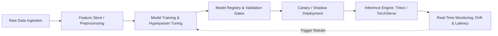

# Comprehensive Project Architecture & Technical Guide: Machine Learning Engineer Nanodegree Portfolio

## 1. Executive Summary & Repository Purpose

This repository houses a full-spectrum machine learning engineering portfolio originating from the **Udacity Machine Learning Engineer Nanodegree**. It encompasses the foundational mathematics, empirical workflows, algorithm implementations, evaluation methodologies, and deep learning architectures that form the backbone of modern applied machine learning.

The repository spans five primary learning stages:
1. **Model Evaluation & Statistical Foundations**: Bias-variance tradeoff, cross-validation, hyperparameter tuning, regression analysis.
2. **Supervised Learning**: Feature engineering, handling skewed continuous data, categorical encoding, binary classification under class imbalance, ensemble boosting algorithms, and model selection.
3. **Unsupervised Learning & Latent Space Analysis**: Data transformation, multivariate outlier detection via Tukey's IQR rule, Principal Component Analysis (PCA) for dimensionality reduction, K-Means clustering, and Gaussian Mixture Models (GMM) optimized with Silhouette coefficients.
4. **Reinforcement Learning**: Markov Decision Processes (MDP), Q-Learning algorithm implementation, dynamic exploration-exploitation scheduling, state-action space design, and reward optimization for autonomous driving agents.
5. **Deep Learning & Computer Vision**: Multilayer Perceptrons (MLP), Convolutional Neural Networks (CNN) with TensorFlow/Keras, transfer learning with pre-trained models (VGG16), and end-to-end capstone system designs.

---

## 2. Global Repository Hierarchy

```
MachineLearning-Demo/
├── .github/workflows/          # Continuous Integration configuration
├── .gitignore                  # Git tracking exclusion rules
├── CODEOWNERS                  # Repository ownership specifications
├── README.md                   # Repository overview and prerequisites
├── PROJECT_EXPLANATION.md      # Comprehensive technical guide (this document)
├── FAANG_INTERVIEW_QUESTIONS.md# Production & FAANG ML interview prep guide
└── projects/
    ├── titanic_survival_exploration/  # Heuristic Decision Boundaries & Classification
    ├── boston_housing/                # Regression, Learning Curves, Bias/Variance
    ├── finding_donors/                # Supervised Classifiers, Skewed Distributions, F-beta
    ├── student_intervention/          # High-Efficiency Model Selection & Latency
    ├── customer_segments/             # PCA, Clustering (K-Means vs GMM), Silhouette Analysis
    ├── smartcab/                      # Q-Learning, MDP, Self-Driving Agent Simulation
    ├── digit_recognition/             # Computer Vision on MNIST
    ├── intro-to-tensorflow/           # TensorFlow Basics & Optimization
    ├── image-classification/          # Deep Convolutional Neural Networks on CIFAR-10
    ├── practice_projects/             # Targeted Deep-Dives:
    │   ├── naive_bayes_tutorial/      # Bag of Words, Bayes Theorem, TF-IDF, Spam Filtering
    │   ├── imdb/                      # Sentiment Analysis with Keras Embeddings/MLP
    │   └── cnn/                       # Transfer Learning (VGG16), CIFAR-10, MNIST
    └── capstone/                      # Production Capstone Proposal & Final System Design
```

---

## 3. Deep-Dive: Project Architectures & Implementations

---

### Project 1: Model Evaluation & Validation (`projects/boston_housing`)

#### 1. Problem Formulation
- **Objective**: Predict median home values ($MDEV$) in Greater Boston communities based on socioeconomic and architectural features.
- **Dataset**: `housing.csv` containing:
  - `RM`: Average number of rooms per dwelling (positive correlation with price).
  - `LSTAT`: Percentage of lower status population (negative correlation with price).
  - `PTRATIO`: Pupil-teacher ratio by town (negative correlation with price).
  - `MEDV`: Target variable (Median value of owner-occupied homes in $1000's).

#### 2. Preprocessing & Exploratory Data Analysis (EDA)
- **Statistical Profiling**: Minimum, maximum, mean, median, and standard deviation calculated across features.
- **Feature Correlation**:
  - Higher `RM` correlates strongly with higher `MEDV`.
  - Higher `LSTAT` indicates lower socio-economic bracket, leading to lower `MEDV`.
  - Higher `PTRATIO` correlates with underfunded public school systems, decreasing neighborhood attractiveness.

#### 3. Mathematical Metric: Coefficient of Determination ($R^2$)
To quantify predictive accuracy, the model uses $R^2$:
$$R^2 = 1 - \frac{SS_{\text{res}}}{SS_{\text{tot}}} = 1 - \frac{\sum_{i=1}^n (y_i - \hat{y}_i)^2}{\sum_{i=1}^n (y_i - \bar{y})^2}$$
- $R^2 = 1$: Perfect predictions.
- $R^2 = 0$: The model predicts the mean of the target variable for all observations.
- $R^2 < 0$: The model performs worse than a horizontal line predicting the mean.

#### 4. Model Selection & Diagnosing Bias vs. Variance
- **Algorithm**: `DecisionTreeRegressor`.
- **Learning Curves**: Plotted training score vs. testing score across varying training sample sizes ($10$ to $300$).
  - *High Bias (Underfitting)*: Both training and testing curves plateau at a low $R^2$. Increasing training samples does not improve testing performance.
  - *High Variance (Overfitting)*: Training score remains near $1.0$, while testing score remains significantly lower with a wide generalization gap.
- **Model Complexity Curves**: Evaluated performance across varying `max_depth` ($1$ to $10$).
  - `max_depth = 1 to 2`: High bias (insufficient capacity).
  - `max_depth = 4 to 5`: Optimal generalization (peak test $R^2$).
  - `max_depth >= 6`: High variance (memorizing noise in the training set).
- **Hyperparameter Optimization**: Applied `GridSearchCV` paired with $10$-fold `KFold` cross-validation to isolate optimal hyperparameters without data leakage.

---

### Project 2: Supervised Learning & Imbalanced Targets (`projects/finding_donors`)

#### 1. Problem Formulation
- **Objective**: Identify individuals earning $> \$50,000$ per year from 1994 U.S. Census data to maximize donation yield for CharityML.
- **Dataset**: `census.csv` with 45,222 records and 13 features (age, workclass, education, marital-status, occupation, capital-gain, capital-loss, hours-per-week, etc.).
- **Target Imbalance**:
  - Individuals earning $> \$50,000$: $24.78\%$
  - Individuals earning $\le \$50,000$: $75.22\%$

#### 2. Advanced Preprocessing Pipeline
- **Logarithmic Transformation on Skewed Features**:
  - Features like `capital-gain` and `capital-loss` exhibit extreme right-skewed distributions with massive zero-inflation and distant outliers.
  - Applied log transformation:
    $$x_{\text{transformed}} = \log_e(x + 1)$$
    This compresses extreme outlier ranges and normalizes gradients for optimization algorithms.
- **Continuous Feature Scaling**:
  - Applied `MinMaxScaler` to scale continuous features into $[0, 1]$:
    $$x_{\text{scaled}} = \frac{x - x_{\min}}{x_{\max} - x_{\min}}$$
  - Prevents features with naturally large scales (e.g., age, hours-per-week) from dominating distance metrics and gradient steps.
- **Categorical Feature Encoding**:
  - Converted nominal categorical columns into binary indicators using One-Hot Encoding (`pd.get_dummies`), expanding the feature dimension from 13 to 103 numerical features.

#### 3. Metric Formulation: $F_{\beta}$-Score ($\beta = 0.5$)
Sending marketing letters costs money. Sending a letter to a non-donor is a waste of capital (False Positive). Missing a donor is an opportunity loss (False Negative), but less costly than active monetary waste. Therefore, **Precision** is more critical than **Recall**:
$$F_{\beta} = (1 + \beta^2) \frac{\text{Precision} \cdot \text{Recall}}{(\beta^2 \cdot \text{Precision}) + \text{Recall}}$$
Setting $\beta = 0.5$:
$$F_{0.5} = \frac{1.25 \cdot \text{Precision} \cdot \text{Recall}}{(0.25 \cdot \text{Precision}) + \text{Recall}}$$
Precision is weighted twice as heavily as recall.

#### 4. Model Benchmarking & Selection
Compared three candidate algorithms across training sample increments ($1\%$, $10\%$, $100\%$):
1. **Gaussian Naive Bayes**: Very fast ($<0.05s$), but poor accuracy and $F_{0.5}$ due to violated feature independence assumptions.
2. **Support Vector Machines (SVC with RBF kernel)**: High accuracy, but $O(n^3)$ training complexity caused unacceptable scaling latency on the full dataset.
3. **AdaBoostClassifier (Ensemble Boosting)**:
   - Base Estimator: `DecisionTreeClassifier(max_depth=1)` (Decision Stumps).
   - Iteratively shifts sample weights toward misclassified points:
     $$w_i^{(t+1)} = w_i^{(t)} \exp\left(-\alpha_t y_i h_t(x_i)\right)$$
   - Outperformed other models in both training time and $F_{0.5}$ score.
- **Feature Importance Analysis**: Extracted `feature_importances_` from the optimized AdaBoost model, identifying `capital-gain`, `capital-loss`, `age`, `hours-per-week`, and `education-num` as the top 5 predictive drivers. Retraining on just these 5 features yielded comparable performance with substantial inference speedups.

---

### Project 3: Unsupervised Learning & Dimensionality Reduction (`projects/customer_segments`)

#### 1. Problem Formulation
- **Objective**: Discover natural spending patterns among wholesale customers in Lisbon, Portugal, enabling targeted distribution and logistics strategies.
- **Dataset**: `customers.csv` containing annual expenditure across 6 product categories: `Fresh`, `Milk`, `Grocery`, `Frozen`, `Detergents_Paper`, and `Delicatessen`.

#### 2. Preprocessing & Outlier Filtering
- **Feature Correlations**: Pairwise scatter matrix revealed strong positive correlations between `Grocery` and `Detergents_Paper` ($r > 0.9$), and `Milk` with `Grocery`.
- **Logarithmic Scaling**: Customer spending spans multiple orders of magnitude (highly skewed). Applied Natural Log Transform:
  $$x_{\text{log}} = \ln(x)$$
- **Tukey’s Outlier Detection (Interquartile Range - IQR)**:
  - For each feature, computed $Q_1$ (25th percentile), $Q_3$ (75th percentile), and $\text{IQR} = Q_3 - Q_1$.
  - An outlier step was defined as $1.5 \times \text{IQR}$.
  - Outlier criteria: $x < Q_1 - 1.5 \cdot \text{IQR}$ or $x > Q_3 + 1.5 \cdot \text{IQR}$.
  - **Strategy**: Removed only data points that were identified as outliers in **two or more features simultaneously**, preserving data volume while filtering truly abnormal multivariate anomalies.

#### 3. Dimensionality Reduction via PCA
- **Eigenvalue Decomposition**: Extracted Principal Components from the centered, log-transformed covariance matrix.
- **Explained Variance**:
  - Dimension 1: Captures spending trade-off between retail/convenience products (`Detergents_Paper`, `Grocery`, `Milk`) vs fresh goods.
  - Dimension 2: Captures spending on food service / restaurants (`Fresh`, `Frozen`, `Delicatessen`).
  - First 2 components accounted for $> 70\%$ of cumulative variance, enabling visual projection without major information loss.

#### 4. Clustering: K-Means vs. Gaussian Mixture Model (GMM)
- **Gaussian Mixture Model (Expectation-Maximization)** was chosen over standard K-Means due to soft-clustering probabilities and elliptical cluster shapes (covariance flexibility).
- **Silhouette Analysis**: Evaluated cluster counts $k \in [2, 10]$ using the mean Silhouette Coefficient:
  $$s(i) = \frac{b(i) - a(i)}{\max(a(i), b(i))}$$
  Where $a(i)$ is the mean intra-cluster distance, and $b(i)$ is the mean nearest-cluster distance.
- **Result**: $k=2$ yielded the highest silhouette score ($~0.42$), delineating the customer base into:
  1. **Retailers / Grocers / Supermarkets**: Dominant spending in `Grocery`, `Milk`, and `Detergents_Paper`.
  2. **Restaurants / Cafes / Hotels**: Dominant spending in `Fresh`, `Frozen`, and `Delicatessen`.

---

### Project 4: Reinforcement Learning (`projects/smartcab`)

#### 1. Problem Formulation
- **Objective**: Train an autonomous agent (*smartcab*) operating on a Manhattan-style city grid to navigate from origin to destination within a strict time deadline while adhering to US Right-of-Way driving laws.
- **Environment**:
  - Grid intersections with traffic lights (`red`, `green`).
  - Autonomous traffic moving North-South and East-West.
  - Driving rules:
    - Red light: Can turn right only if oncoming traffic is clear; cannot move forward or turn left.
    - Green light: Can move forward or turn right freely; must yield to oncoming straight traffic when turning left.

#### 2. MDP & State-Action Representation
- **State Space $S$**:
  The state must be minimal to prevent the curse of dimensionality while retaining complete Markovian property:
  $$s = (\text{light}, \text{oncoming}, \text{left}, \text{next\_waypoint})$$
  - `light`: `red` or `green` (2 states).
  - `oncoming`: `None`, `forward`, `left`, `right` (4 states).
  - `left`: `None`, `forward`, `left`, `right` (4 states).
  - `next_waypoint`: `forward`, `left`, `right` (3 states).
  - Total Discrete State Space: $2 \times 4 \times 4 \times 3 = 96$ states.
- **Action Space $A$**:
  $$a \in \{\text{None (idle)}, \text{forward}, \text{left}, \text{right}\}$$

#### 3. Reward Function Design
- Reaching destination safely: $+10$ to $+12$.
- Minor action following waypoint legally: $+1.5$ to $+2.0$.
- Minor traffic violation (e.g., turning right on red without oncoming, but not yielding perfectly): $-0.5$ to $-1.0$.
- Severe violation (e.g., running red light, failing to yield on left turn resulting in traffic blockage/collision): $-10$ to $-20$.

#### 4. Q-Learning Algorithm
The agent maintains a Q-Table $Q(s, a)$ initialized to zeros. At each step $t$:
$$Q(s_t, a_t) \leftarrow (1 - \alpha) Q(s_t, a_t) + \alpha \left[ R_{t+1} + \gamma \max_{a} Q(s_{t+1}, a) \right]$$
- $\alpha$: Learning rate ($0 < \alpha \le 1$).
- $\gamma$: Discount factor for future rewards ($0 \le \gamma < 1$). For smartcab navigation, $\gamma$ is tuned so immediate safety does not get overwhelmed by uncertain long-term rewards.

#### 5. Exploration vs. Exploitation Decay Schedules
Using an $\epsilon$-greedy policy:
$$\pi(a|s) = \begin{cases} \arg\max_{a} Q(s, a), & \text{with probability } 1 - \epsilon \\ \text{uniform random action}, & \text{with probability } \epsilon \end{cases}$$
- Default linear decay ($\epsilon \leftarrow \epsilon - 0.05$) causes the agent to stop exploring too early before all $96$ state transitions have been visited.
- Optimized non-linear decay schedule:
  $$\epsilon = a^t \quad \text{or} \quad \epsilon = \cos(a \cdot t)$$
  Allowing thousands of trials with sustained early exploration followed by asymptotic decay toward pure exploitation ($\epsilon < 0.01$), achieving an **A+ Safety Rating** (zero major traffic violations) and **A+ Reliability Rating** ($>95\%$ on-time trip completion).

---

### Project 5: Deep Learning & Computer Vision (`projects/image-classification`)

#### 1. Problem Formulation
- **Objective**: Classify $32 \times 32$ RGB images from the **CIFAR-10** benchmark dataset across 10 mutually exclusive classes: `airplane`, `automobile`, `bird`, `cat`, `deer`, `dog`, `frog`, `horse`, `ship`, `truck`.
- **Input Dimension**: $32 \times 32 \times 3$ tensors.

#### 2. Architecture Design
```
Input (32x32x3)
  │
  ├── [Conv2D: 32 filters, 3x3, Stride 1, Padding 'SAME'] -> ReLU
  ├── [Conv2D: 64 filters, 3x3, Stride 1, Padding 'SAME'] -> ReLU
  ├── [MaxPool2D: 2x2, Stride 2] (Output: 16x16x64)
  ├── [Dropout: 0.25]
  │
  ├── [Conv2D: 128 filters, 3x3, Stride 1, Padding 'SAME'] -> ReLU
  ├── [MaxPool2D: 2x2, Stride 2] (Output: 8x8x128)
  ├── [Dropout: 0.25]
  │
  ├── [Flatten] (8 * 8 * 128 = 8,192 units)
  ├── [Dense / Fully Connected: 512 units] -> ReLU
  ├── [BatchNormalization]
  ├── [Dropout: 0.5]
  │
  └── [Dense / Output: 10 units] -> Softmax
```

#### 3. Loss Function & Optimization
- **Loss**: Multi-Class Categorical Cross-Entropy:
  $$\mathcal{L}_{CE} = -\sum_{c=1}^{10} y_c \log(\hat{y}_c)$$
  Where $\hat{y}_c = \frac{e^{z_c}}{\sum_{j=1}^{10} e^{z_j}}$ (Softmax probabilities).
- **Optimization**: Adam Optimizer ($\beta_1=0.9, \beta_2=0.999, \epsilon=10^{-8}$) with adaptive learning rate.
- **Regularization**:
  - Dropout ($p=0.25$ and $p=0.5$) preventing co-adaptation of hidden features.
  - Data Augmentation (random horizontal flips, shifts, zooms) to expand the training manifold and enhance invariance.

---

## 4. Cross-Project Summary Matrix

| Project Name | Domain | Primary Algorithm(s) | Key Metric(s) | Primary Engineering Challenge |
| :--- | :--- | :--- | :--- | :--- |
| **Boston Housing** | Supervised Regression | Decision Tree Regressor, K-Fold CV | $R^2$ Score, MSE | Diagnosing underfitting vs. overfitting via Learning/Complexity Curves |
| **Finding Donors** | Supervised Classification | AdaBoost, Random Forest, SVM | $F_{0.5}$ Score, Precision, Accuracy | Skewed continuous features, class imbalance ($75/25$), feature selection |
| **Customer Segments** | Unsupervised Learning | PCA, Gaussian Mixture Models, K-Means | Silhouette Coefficient, Explained Variance | Multi-feature outlier filtering (Tukey's IQR), soft vs hard clustering |
| **Smartcab** | Reinforcement Learning | Tabular Q-Learning, $\epsilon$-greedy | Safety Rating, Reliability Rating | State space discretization, reward function shaping, exploration decay |
| **Image Classification** | Deep Learning / CV | Deep CNN, Mini-Batch Adam | Categorical Cross-Entropy, Top-1 Acc | Spatial invariance, vanishing gradients, regularizing high parameter count |

---

## 5. Production ML Engineering & MLOps Considerations

To take these academic implementations to FAANG-scale production systems, several critical enhancements must be introduced:



1. **Feature Store Integration**:
   - Centralize transformations like log-scaling, standard scalers, and categorical embeddings (e.g., using Feast or Hopsworks) to prevent train-serve skew.
2. **Offline vs. Online Validation**:
   - Moving from single static train-test splits to walk-forward time-series validation or stratified grouped cross-validation.
3. **Model Serving & Latency**:
   - Compiling PyTorch/TensorFlow models via ONNX Runtime or TensorRT for low p99 latency inference.
4. **Monitoring & Drift Detection**:
   - Population Stability Index (PSI) and Kolmogorov-Smirnov (KS) tests to monitor continuous feature drift in real-time.
